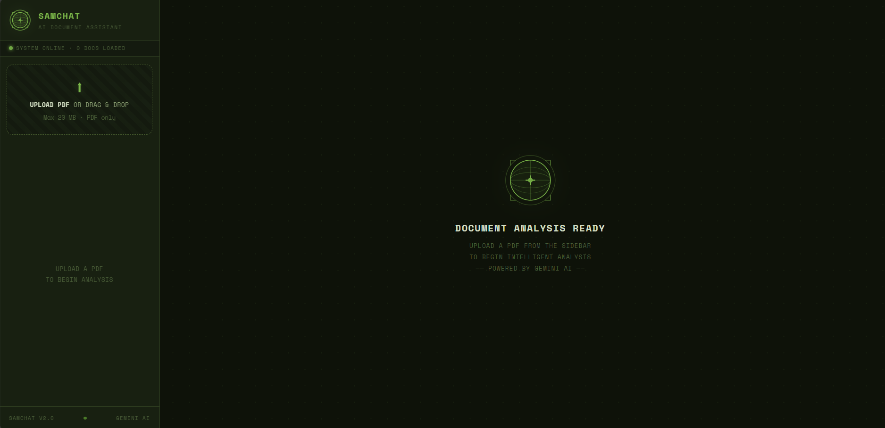
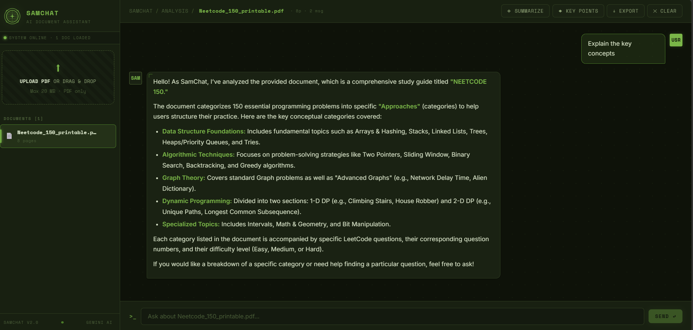

# SamChat

SamChat is an AI-powered document assistant that allows users to upload PDF files and interact with them using natural language. The application extracts text from uploaded documents, retrieves relevant sections based on user queries, and generates responses using the Google Gemini API.

The project is built with React and Flask, following a simple client-server architecture, and is designed to be easily extendable with features like vector search, OCR, authentication, and persistent storage.

---

## Features

* Upload one or multiple PDF documents
* Ask questions about uploaded documents
* Generate document summaries
* Extract important points from a document
* Chat across multiple uploaded PDFs
* Export chat history as a text file
* Remove uploaded documents and clear conversations

---

## Tech Stack

### Frontend

* React 18
* Vite
* Axios
* React Context API

### Backend

* Python
* Flask
* PyMuPDF (fitz)

### AI

* Google Gemini 1.5 Flash API

---

## Project Structure

```
samchat/
│
├── client/
│   ├── src/
│   │   ├── components/
│   │   │   ├── ChatWindow.jsx
│   │   │   └── Sidebar.jsx
│   │   ├── context/
│   │   │   └── DocContext.jsx
│   │   ├── pages/
│   │   │   └── ChatLayout.jsx
│   │   ├── api.js
│   │   └── App.jsx
│
└── server/
    ├── controllers/
    │   ├── chat_controller.py
    │   └── pdf_controller.py
    ├── routes/
    │   └── routes.py
    ├── utils/
    │   ├── gemini_utils.py
    │   └── pdf_utils.py
    ├── app.py
    ├── requirements.txt
    └── .env.example
```

---
## Screenshots

**Landing Screen**



**Summarize & Key Points**



## Getting Started

### Prerequisites

* Python 3.10+
* Node.js 18+
* Google Gemini API Key

Generate an API key from Google AI Studio and add it to the backend environment file.

---

### Backend Setup

```bash
cd server

python -m venv venv
```

Windows

```bash
venv\Scripts\activate
```

macOS/Linux

```bash
source venv/bin/activate
```

Install dependencies

```bash
pip install -r requirements.txt
```

Create a `.env` file using `.env.example` and add your Gemini API key.

```
GEMINI_API_KEY=your_api_key
```

Run the server

```bash
python app.py
```

The backend starts on

```
http://localhost:5000
```

---

### Frontend Setup

```bash
cd client

npm install

npm run dev
```

The frontend will be available at

```
http://localhost:5173
```

---

## API Endpoints

### PDF

| Method | Endpoint                 | Description             |
| ------ | ------------------------ | ----------------------- |
| POST   | `/api/pdf/upload`        | Upload a PDF            |
| GET    | `/api/pdf/documents`     | List uploaded documents |
| DELETE | `/api/pdf/documents/:id` | Delete a document       |

### Chat

| Method | Endpoint                | Description           |
| ------ | ----------------------- | --------------------- |
| POST   | `/api/chat/`            | Send a question       |
| POST   | `/api/chat/summarize`   | Generate a summary    |
| POST   | `/api/chat/keypoints`   | Extract key points    |
| GET    | `/api/chat/history/:id` | Retrieve chat history |
| DELETE | `/api/chat/history/:id` | Clear chat history    |
| POST   | `/api/chat/export`      | Export conversation   |

---

## Implementation Details

The application currently uses a lightweight retrieval approach.

* PDF text is extracted using PyMuPDF.
* Documents are divided into manageable chunks.
* Relevant chunks are selected through keyword matching.
* Selected content is sent to Gemini along with the user's prompt.
* Conversation history is maintained to support follow-up questions.

Although this is not a full vector-based Retrieval-Augmented Generation (RAG) pipeline, the project is structured so that semantic retrieval can be integrated later with minimal changes.

---

## Future Improvements

Some planned enhancements include:

* Semantic search using vector embeddings
* OCR support for scanned PDFs
* User authentication
* Persistent database storage
* Support for DOCX and TXT documents
* Improved document management
* Streaming AI responses
* Docker support

---

## License

This project is intended for learning and personal development. Feel free to fork, modify, and extend it for your own use.
do mention credits to @sm-daniyal
